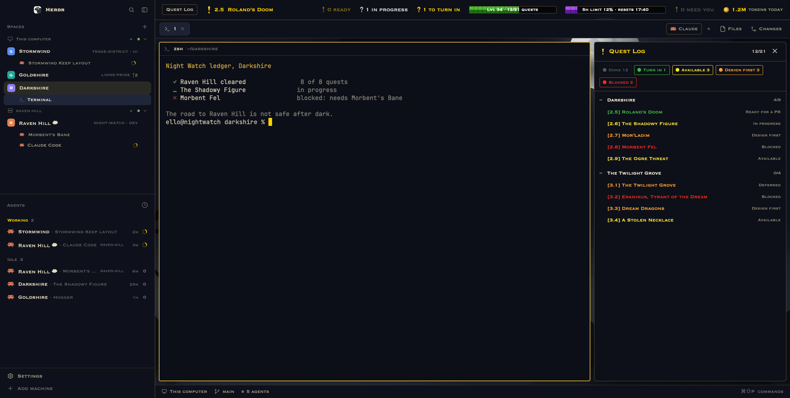

# Duskwood for Herdr

A World of Warcraft layout for [Herdr](https://herdr.dev): a moonlit Duskwood
graveyard behind see-through panes, and your BMAD stories played as quests.

The layout is in [`duskwood/`](duskwood): `layouts/`, `mods/`, `themes/`,
`backgrounds/`, a `RECIPE.md` another agent can build it from, and
`preview.png`. To add it, ask your agent to add
`github.com/ThomasR1997/herdr-duskwood` and follow its recipe's notes.
