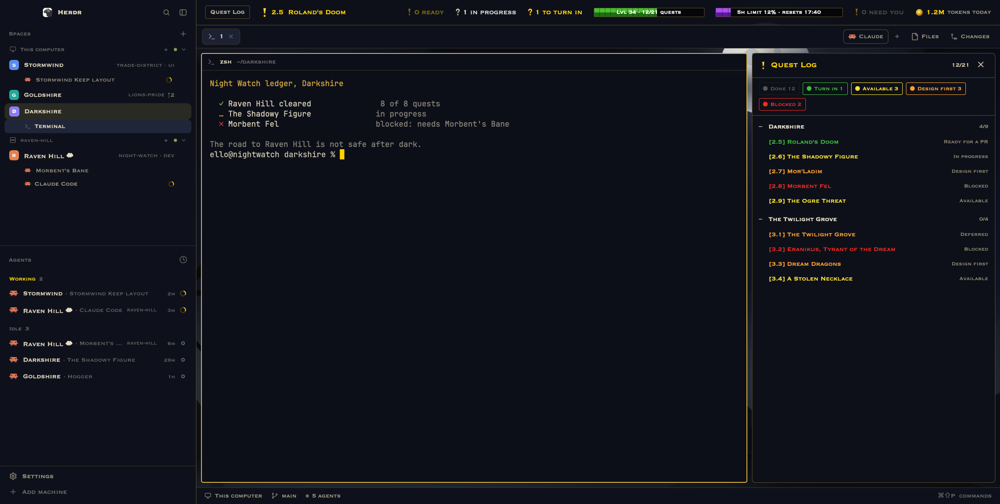

# Duskwood

A World of Warcraft layout for Herdr, set in Duskwood at night: a moonlit
graveyard behind see-through panes, gold-on-bronze chrome in Copperplate, and
your BMAD stories played as quests. A quest bar across the top shows the next
quest with a yellow **!**, counts what's ready, in progress and ready to turn
in, and draws a green reputation bar for sprint progress and a purple
experience bar for Claude's 5-hour limit. A quest log slides out on the right
with WoW's difficulty colours, sessions are listed under their spaces with an
archive/delete menu, the status bar shows and switches the focused Claude's
model and effort, and finishing enough stories plays a golden "Level Up!" with
a ding.

## What you see

Left to right, top to bottom. Colours are the `duskwood` theme
(`themes/duskwood.json`) unless given.

- **The window** has no system title bar (`"titlebar": "none"`, macOS
  traffic lights at `[12, 16]`). Its background is `backgrounds/duskwood.png`
  (2560×1600, `fit: cover`): a full moon behind clouds at the top right, bare
  dead trees on the left, two misty treelines, a graveyard with crosses and
  headstones on a hill at the bottom right, ground fog, and a pair of yellow
  worgen eyes in the dark. Mostly near-black blues (`#05070e` to `#151a24`),
  so terminal text stays readable over it. `duskwood.svg` is its source.
- **Sidebar, 268 px, `#0b0e17e6`** (the picture shows faintly through):
  Herdr's brand row (46 px), then **Spaces** and **Agents** at equal height,
  then the footer (69 px). Spaces are grouped by machine as in Herdr; under
  each space, its **sessions** (tabs) are listed indented 36 px, 24 px high,
  12.5 px text: the program's icon, the agent's own title (Claude's session
  name; a tab named only after its program gives way to it; a plain shell
  reads "Terminal"), a gold spinner while working or a dot when blocked/done,
  and a ⋯ slot on the right.
- **Quest bar, 46 px, `#0d1019f0`, bronze bottom border `#5c4d2e`, 14 px
  Copperplate**, left to right:
  - a bordered **Quest Log** button;
  - the **next quest**: a yellow **!** marker (13×20) and `9.1  Title` in WoW
    quest gold `#ffd100`, truncated;
  - three counters, each a marker and text, dimmed to 45% at zero:
    yellow **!** `N ready`, grey **?** `N in progress`, yellow **?**
    `N to turn in`;
  - a **reputation bar**, 200×17, green halves `#45c22c` / `#1f6e12`:
    `Lvl 34 · 12/21 quests`;
  - an **experience bar**, 230×17, purple halves `#b04cff` / `#5c1a9c`:
    `5h limit 46% · resets 17:40`;
  - `N needs you` with a red **!** (`#ff6b5a`), or dimmed at zero;
  - a gold coin and `1.2M tokens today`.
  Every bar is drawn WoW-style: `#05060a` inside a 1 px `#5c4d2e` frame,
  rounded 2, a fill of two flat halves (top lighter), twenty segment ticks
  (`#00000066` 1 px lines) and a centred white 11 px label.
  In a space without BMAD it reads `<space>: no quest log here` and keeps
  the right-hand half.
- **Tab bar, 42 px**: Herdr's tab pills, then a **Claude** button (Claude's
  icon and "Claude", 1 px `#5c4d2e` border, gold text and border on hover),
  then **+**, **Files**, **Changes**.
- **Work area**, padding 8, gap 8: the shown tab's panes as cards (background
  `#0a0d16c8`, 1 px `#4a3f28` border, **2 px `#d4a93a` gold border on the
  focused pane**, radius 4, gap 8, Herdr's `pane` header 30 px on top, a lone
  pane framed too). Terminals are at `terminal_opacity` 0.86 with padding
  `[14, 12]`, so the picture shows behind them. Files/Changes (368 px) and
  the **quest log** (440 px, radius 6, `#5c4d2e` border) are hidden until
  opened.
- **Quest log**: `#0d1019`. A 44 px header (yellow **!**, "Quest Log" in gold
  16 px, `done/total`, ✕). A row of filter chips that double as the legend,
  each a dot and `Label N` in its colour: **Done** `#9d9d9d`, **Turn in**
  `#40c040`, **Available** `#ffe633`, **Design first** `#ffa033`,
  **Blocked** `#ff2a1f`; Done is off at first. Then the epics like WoW zones
  (`–`/`+`, title in `#efe6cf`, `done/total`), and under each its quests as
  `[2.5] Title` in the difficulty colour, a small gold map pin when a
  session works on it, and its status word right-aligned in `#8f8770`. A
  selected quest opens a **parchment page** below (330 px, `#e6d6ac`, ink
  `#2e1f0b`, headings `#6b3d00`): a coloured dot and `id  Title` 15 px,
  **Description** (the story's "As a… I want… So that…"), a heading with the
  status label and its note (the blocker for a red quest), and a dark button
  row (`#1a140a`) of red-and-gold buttons (`#7a150d`, 1 px gold border).
- **Status bar, 30 px**: Herdr's (machine, branch, agents), and on the right
  for the focused Claude: its **model** in gold in a bordered chip, an
  **effort** chip of five pips (gold up to the level, `#3a3426` after) and
  the level's name, `context 27%`, and `· busy` while it works.

## How it behaves

- **Agent status.** Working: a gold spinner on the session row and the tab
  pill, and the agent counts as working in the Agents list. Blocked: a red
  dot on the row, and `N needs you` turns red with a red **!**. Done
  (finished unseen): a green dot, and it counts in `needs you` too. Idle:
  nothing. Clicking `needs you` jumps to the first of them.
- **Quest bar.**
  - **Quest Log** opens or closes the quest log.
  - Clicking the next quest asks **Accept / Decline** inline. Accept opens a
    tab named `! 9.1` running the launcher with `/bmad-build 9.1` (plain
    `claude` on another machine).
  - The yellow **?** jumps to the next session working on a turn-in story,
    one per click (waiting ones first); a story with no session opens its
    pull request in the browser.
  - The experience bar opens an **Experience** tooltip (300 px, `#0a0c16f2`,
    1 px `#c9a227`): the 5-hour limit (purple), the weekly limit (blue
    halves `#4f9cff` / `#1c4f9c`, "Resets Sun 02:00 (in 3 days)"), and the
    last focused window's context (green), its tokens, model, effort and
    session name. It refreshes every 2 s; a click closes it.
  - The coin opens **Gold**: tokens today, in the last 7 days and all time
    (since the oldest day Claude kept), split by machine when more than one
    has used any.
- **Level up.** The level is `floor(done / total × 60)`. When it rises past
  the one last seen for that repo, a frameless 560×360 window shows a golden
  burst (`level-up/burst.svg`) that swells from the centre, pulses, and fades,
  behind "Level Up!" (56 px gold with a dark outline made of nudged copies)
  that rises into place over "You have reached Level 44"; `ding.wav` plays.
  It closes after 4.3 s or on a click. The first sight of a repo only records
  its level, so it never dings on start.
- **Quest log.** Chips filter by colour; an epic header folds it; a quest
  opens its page. Buttons: **Show on Map** when a session works on it (jumps
  there, cycling through several, "Show on Map (2)"); otherwise **Accept**
  for a yellow quest; **Open PR #415**; **Open story** (its spec file).
- **Difficulty colours.** Grey: done. Green: an open pull request names it,
  or a worktree has it at `review` before the main branch does ("Ready for a
  PR"), or the main branch has it at `review` ("Merged · awaiting your
  check"). Yellow: in progress, ready to build, or plainly open. Red:
  `BLOCKED` on its epics.md status line. Orange: `deferred`, `paused`, or a
  status mentioning design or rework ("Design first").
- **Sessions in the sidebar.** Click: that space and tab. Hover: ⋯ appears;
  ⋯ or right-click opens a small menu that takes the keyboard: **Archive
  (A)** settles the tab (put away, still running; it leaves the sidebar and
  the tab bar, stays in the Agents list, and comes back when shown or when it
  needs you), **Delete (D)** asks once ("Ends its sessions…", noting when it
  closes the space), then D or Enter deletes, Esc cancels. Hovering a space
  shows **+** on its row: a new Claude session in that space.
- **Claude button** and **+**: a new Claude session in the shown space.
- **Model and effort.** Clicking the model chip or effort chip opens a menu:
  Fable 5.2, Opus 5.5, Sonnet 5.5, Haiku 5.5 (gold ◆ on the current one), or
  low to max. A pick types `/model claude-opus-5-5` or `/effort xhigh` into
  that Claude, only while it waits for a prompt (idle or done); otherwise a
  "Not switched" notice. The chips aren't clickable while it's busy.
- **What moves.** Spinners (`spin`), the burst's pulse (`loop` on opacity),
  the level-up transitions. Nothing else animates; data refreshes on timers.

## Built from

- **Layout** `layouts/duskwood.json`, a clone of Herdr's `main`:
  `root` row (theme `duskwood`, `ui_font` Copperplate, background image,
  `terminal_opacity` 0.86, divider 1 px `#5c4d2e`) →
  `sidebar` column (268, `#0b0e17e6`): `brand` (`workspace-chrome`, 46),
  `sidebar-lists` column [`spaces` → **`duskwood-spaces`**, `agents` →
  `agents`], `sidebar-footer` (`workspace-chrome` `{footer: true}`, 69) →
  `work` column: `quests` → **`quest-bar`** (46), `tabs` →
  **`duskwood-tabs`** (42), `work-body` row [`main` `{tab: "active"}` with the
  pane frame above, `panel` stack of `files`/`changes` (hidden, 368),
  `questlog` → **`quest-log`** (hidden, 440)], `status` →
  **`duskwood-status`** (30).
- **Theme** `themes/duskwood.json`: background `#0c0f18`, foreground
  `#d6ccb4`, selection `#33405e`, cursor `#ffd100`; ANSI `#1a1e2a #b4413b
  #78a35a #d1a33c #5f81b8 #9467b0 #5fa6a3 #c4bca8` / bright `#4a5068 #e0584c
  #9ccf6e #ffd100 #86a8e0 #b98ad6 #86d0c9 #efe6cf`; colours canvas
  `#080a11`, chrome `#0e111b`, surface `#121624`, popover `#151a2a`, raised
  `#1c2234`, hover `#1f2639`, selected `#2a2a24`, border `#3a3426`, input
  `#5c4d2e`, foreground `#e6dcc2`, muted `#a39a84`, dim `#6b6a6a`, accent
  `#d4a93a`, solid `#c9962a`, working `#ffd100`, blocked `#e0584c`, done
  `#9ccf6e`, idle `#5d6580`.
- **Mods** (new): `quest-bar`, `quest-log`, `level-up`, `usage-card`,
  `gold-card`, `model-menu`, `session-menu`. **Clones** of Herdr's own:
  `duskwood-spaces` (`spaces` + session rows, hover ⋯ and +),
  `duskwood-tabs` (`tabs` + Claude button, settled tabs hidden),
  `duskwood-status` (`workspace-status` + model/effort/context chips).
  **Shipped, used as is**: `workspace-chrome`, `agents`, `pane`, `files`,
  `changes`, `new-menu`, `menu`.
- **Helpers in `mods/quest-bar/`:**
  - `quests.py <folder> [--remote] [--log]`: one JSON line. Reads
    `_bmad-output/implementation-artifacts/sprint-status.yaml`
    (`development_status`) from the working copy and from
    `origin/<HEAD branch>` via `git show` (furthest status wins; the main
    branch's order first), story titles, story text and `**Status:**` words
    from `_bmad-output/planning-artifacts/epics.md`, `git worktree list`, and
    open pull requests (`gh pr list`, cached in `.cache.json` beside it).
    `--remote` first runs `git fetch origin <branch>` and refreshes the PR
    list. The next quest is the first unfinished story after the last done
    one, as the bmad-stories plugin picks it.
  - `tokens.py <utc offset minutes>`: tokens per local day from
    `~/.claude/projects/**/*.jsonl` (subagents included): input + cache
    writes + output, each message id once; changed files only, cached in
    `~/.claude/herdr/token-cache.json`.
  - `statusline-herdr.py`: Claude Code's `statusLine` command. Saves
    `rate_limits` to `~/.claude/herdr/rate-limits.json` and, keyed by
    `HC_TERMINAL_ID`, the model, effort, context % and tokens, window size
    and session name to `~/.claude/herdr/sessions/<t>.json`; prints
    `Opus 5.5 · xhigh  ·  5h ▰▰▰▱▱ 46% · resets 17:40`.
  - `claude-session [task]`: starts `claude --model opus --effort xhigh
    [task]`. In a repo listed in `~/.config/herdr-app/cloud-repos`
    (`owner/name` per line) it starts a cloud session instead: asks for the
    task when none was given, runs `claude --cloud "<task>"` under `script`
    (it needs a terminal), opens the session's link, and leaves a card with
    **o** (open again), **t** (`claude --teleport`), **q** (close the tab).
  - `ding.wav`: a synthesised two-note bell.
- **Refresh.** The quest bar ticks every 5 s (the 5-hour file). Every 60 s,
  and at once when the shown space changes, it runs `quests.py --remote` and
  `tokens.py`; when the quest output changes it sets shared
  `quests.updated`, and the quest log, which watches it, reads again within
  5 s. Spaces on another machine run the helpers there: copied once per load
  to `~/.herdr-quests/` with `hc file write --on <machine>`, run with
  `exec(..., { on })`; session files are read with `readTextFile(path,
  { on })` under that machine's `$HOME`. Tokens are counted on this machine
  and on every machine whose `machines()` layout is `ready`, then summed.
- **herdr functions and commands:** `spaces`, `agents`, `panes`,
  `machines`, `focused`, `theme`, `shared`/`setShared`, `exec`, `hc`,
  `readTextFile`, `openOverlay`/`closeOverlay`, `notify`, `playSound`,
  `localStorage`; `run` of `layout.toggle`, `layout.hide`, `tab.new`,
  `tab.select`, `tab.settle`, `tab.unsettle`, `tab.close`, `space.select`,
  `pane.focus`.
- **Programs run:** `python3`, `git`, `gh`, `hc`, `claude`, `open`, `script`.
- **Art:** `backgrounds/duskwood.svg` rendered to PNG with headless Chrome;
  the quest markers (`excl.svg`, `excl-red.svg`, `quest-active.svg`,
  `quest-turnin.svg`), `coin.svg`, `pin.svg` and `burst.svg` are hand-drawn
  SVG paths (no text: fonts don't render in SVG here).

## Watch out

- **Before installing:** these mods run programs (`python3`, `git fetch`,
  `gh`, `hc`, `claude`, `open`, `script`), reach GitHub through `git` and
  `gh`, and read files outside their folders: the repo's BMAD files,
  `~/.claude/projects` and `~/.claude/herdr/`.
- **Two folders sit outside `mods/`**: copy `themes/duskwood.json` and
  `backgrounds/` into the Herdr home too, or the layout has no theme and no
  picture.
- **Claude's status line** has to be set by the person: add `"statusLine":
  { "type": "command", "command": "python3 -I
  ~/.config/herdr-app/mods/quest-bar/statusline-herdr.py" }` to
  `~/.claude/settings.json`. Without it the experience bar waits, and the
  model/effort chips and context stay empty. Effort is also stored per model
  (`modelSettings.<model id>.effortLevel`); set both for a default.
- **GPUI here:** `.bg()` takes a colour, not a gradient (bars are two flat
  halves); `"transparent"` isn't a colour (`#00000000` is); `transition`
  animates later changes, so start at phase 0 and change the target on a
  40 ms timer. `agent.focus` doesn't switch spaces: jump with `pane.focus
  {pane}`.
- **Typing into Claude:** `hc send` from inside a terminal wraps the text in
  `<hc from="t3">…</hc>`, which Claude reads as a chat message. Mods aren't
  terminals, so the model menu's sends arrive as commands; don't test them
  from a shell. `hc send --if idle` refuses `done`; check `agents()` status
  yourself.
- **`claude --cloud`** needs a description and a terminal (hence `script`);
  attaching to a running cloud session may not be enabled for an account.
- **Another machine:** never query one that isn't `ready`; reaching a
  stopped GitHub Codespace through `gh codespace ssh` starts it. In a
  Codespace, run `gh auth setup-git`, or git can't authenticate from
  Herdr's terminals.
- `.cache.json` holds the repo's open PR titles: don't share it.
- Copperplate ships with macOS; elsewhere the panels fall back to Herdr's
  font. Level tops out at 60. "All time" tokens only reach as far back as
  Claude keeps its history. Cache reads are left out of every count.
- Assumes Claude Code, `gh` signed in, Python 3, and a BMAD v6 project
  (`_bmad-output/…`); without one the bar shows only limits, needs-you and
  gold.

## Done when

- `herdr-app check` passes for each of the ten mods, and `layout.switch
  {"name": "duskwood"}` shows the picture behind see-through panes with
  gold focus borders and Copperplate panels.
- In a BMAD repo the quest bar shows the next quest, the three counts and
  `Lvl N · done/total quests`, matching `quests.py <repo>` run by hand; in a
  non-BMAD space it says "no quest log here".
- With the status line installed, the experience bar shows the 5-hour %
  and reset time, and clicking it opens Experience with both limits and the
  focused Claude's context.
- The coin shows today's tokens, and Gold shows today ≤ 7 days ≤ all time.
- Quest Log opens the panel; quests have the five colours by the rules
  above; Done is hidden until its chip is clicked; a blocked quest's page
  shows its blocker.
- Accept opens a `! <id>` tab running Claude with `/bmad-build <id>`, and
  that quest then shows a pin and **Show on Map**, which jumps to it.
- A merged PR leaves "to turn in" within a minute.
- Sessions are listed under their spaces; ⋯ → A hides one from the sidebar
  and the tab bar while it keeps running; ⋯ → D, D deletes it.
- The model and effort chips show the focused Claude's, and picking another
  changes both the chip and Claude's footer within a few seconds.
- Raising `done` by enough to pass a level plays the burst and the ding
  once.
